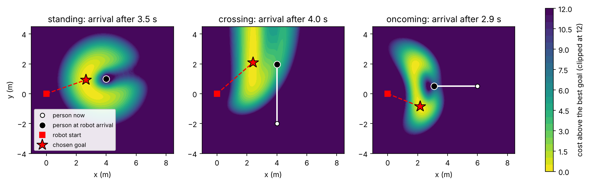
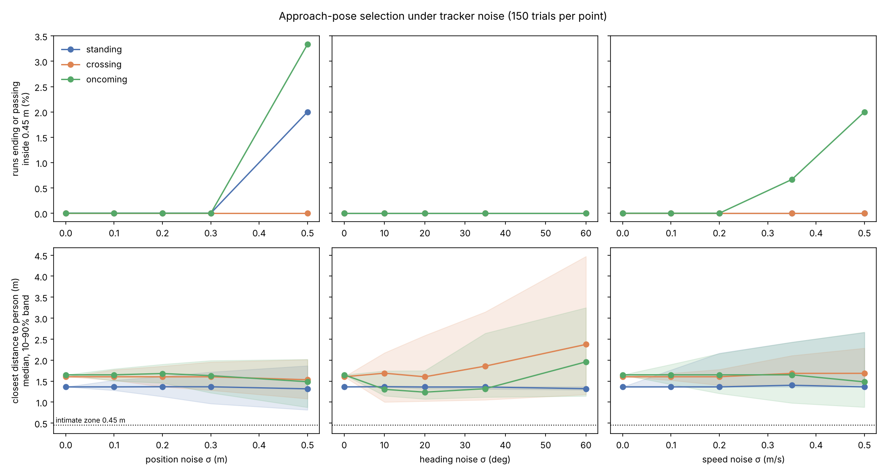
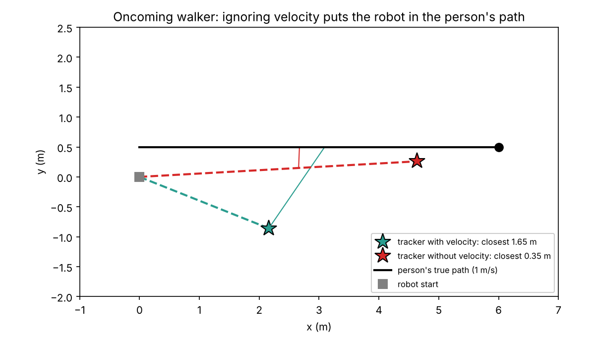
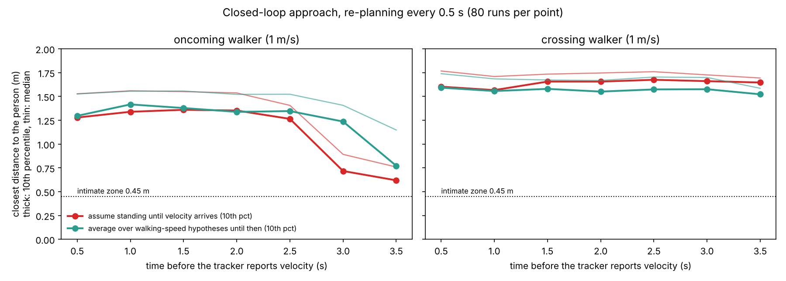

# Social approach-pose selection under people-tracking errors

A robot needs to approach a person, standing or walking, to start an interaction. It chooses a
goal point that is socially acceptable *where the person will be when the robot arrives*. This
repository re-implements that idea in a simplified form, then asks one question:

**The method assumes a tracked person state (position, heading, speed). How much do realistic
tracker errors change the chosen pose, and when do they make the robot end up too close?**

The approach-pose idea comes from Ngo and Nguyen, *Spatiotemporal Motion Profiles for Cost-Based
Optimal Approaching Pose Estimation*, IEEE/SICE SII 2024. This is **not** their code or their exact
cost function. It is a small, transparent version built to study the perception side of the
problem.



## Model

Each candidate goal point g gets a cost. The person is predicted at constant velocity to the time
T at which the robot, moving straight at 0.8 m/s, would reach g. The cost has five terms:

| Term | Meaning |
|---|---|
| Personal space | Asymmetric Gaussian around the predicted person: larger ahead, smaller behind (Kirby, 2009). Its size grows with walking speed |
| Distance | Deviation from a 1.2 m conversation distance (Hall's social-zone boundary) |
| Visibility | Penalty for arriving outside the person's forward view, so they see the robot coming |
| Path intrusion | The worst personal-space intrusion along the robot's path, with the person moving at the same time. This is the spatiotemporal part |
| Time | Arrival time |

The goal is the minimum over a 5 cm to 8 cm grid. The figure above shows the resulting cost
fields:

- **Standing person:** a ring in front.
- **Person walking across the robot's view:** a band beside their path.
- **Person walking toward the robot:** a pocket diagonally ahead of them.

### One modelling choice to flag

Kirby's personal-space model was designed for robots *passing* people. It makes the space ahead
of a 1 m/s walker about 2 m deep. With it, the robot chose to approach walkers **from behind**,
which is socially wrong. I reduced the speed scaling for the approach task (`0.5 + 0.5·v` instead
of `max(2v, 0.5)`) and raised the visibility weight. The robot then approaches from the front-side.
How a passing model should change for engagement seems like an open question in itself.

## Experiment

Three scenarios: standing, crossing (1 m/s across the robot's view) and oncoming (1 m/s toward
the robot). Tracker error is added to the person state the planner sees. The chosen goal is then
scored against the person's **true** motion.

- Position noise σ = 0 to 0.5 m; heading noise σ = 0 to 60°; speed noise σ = 0 to 0.5 m/s.
  This gives 150 trials per setting and 5,409 goal selections in total.
- A common tracker failure was also tested: no velocity estimate, so every person is treated as
  standing.
- **Violation:** at any point on the approach, the robot comes within 0.45 m of the person
  (Hall's intimate zone).



## Findings

1. **The cost-based selection is robust to ordinary tracker noise.** Up to 0.3 m position noise,
   35° heading noise and 0.2 m/s speed noise, there were no violations in any scenario. Even at
   0.5 m position noise, violations stayed at 3.3% or below.
2. **Heading errors make the robot miss walkers.** For the crossing person, 60° of heading noise
   raises the median closest distance from 1.6 m to 2.4 m. The robot goes where the person was
   heading, not where they went, so the approach fails safely but socially: it never reaches
   conversation distance.
3. **Missing velocity is the dangerous failure.** Treat the oncoming walker as standing, and the
   robot drives toward where they *were*. The person walks into its path and the closest distance
   falls from 1.65 m to **0.35 m**, inside the intimate zone. For the crossing walker the same
   failure leaves the robot 3.3 m from where the person ends up.



The practical reading: for spatiotemporal approach planning, *whether the tracker estimates
velocity at all* matters far more than how accurate its position is.

## Part 2: does re-planning fix it?

Finding 3 assumes the robot commits to one goal. Real robots re-plan, and a tracker can estimate
velocity once it has watched the person for a moment. So I closed the loop:

- **Re-planning:** the robot re-chooses its goal every 0.5 s from where it currently is.
- **Tracker:** reports noisy position (σ 0.1 m) and body orientation (σ 10°) at every step.
  Velocity is a finite difference of noisy positions and is only reported after a delay.
- **Two policies while velocity is still missing:**
  - *naive:* assume the person is standing;
  - *robust:* average the cost over walking speeds of 0, 0.4, 0.8, 1.2 and 1.5 m/s along the
    person's facing direction.

**One-shot first** (`src/robust.py`). Planning once over speed hypotheses does not solve it. The
worst-case version still ends 0.33 m from the oncoming walker. The averaging version keeps both
walkers safe, but makes the robot stop 2.4 to 2.8 m short of people who really are standing.

**Closed loop with a 1 s velocity delay** (`src/replan.py`, 100 runs per case). Both policies are
safe in all four scenarios (standing, crossing, oncoming, standing sideways). There are 0
violations, and the robot ends within conversation range (0.8 to 2.0 m) in 99 to 100% of runs.

**How long can velocity be missing?** (`src/latency_sweep.py`, 80 runs per point.)



- **Up to 2.5 s of delay, both policies are safe.**
- **From 3 s, the naive policy degrades for an oncoming walker.** The worst-10% closest distance
  falls from about 1.3 m to 0.72 m, then 0.62 m at 3.5 s, and 1 of 80 runs enters the intimate
  zone.
- **The speed-hypothesis policy holds about half a second longer.** Its worst-10% distance is
  still 1.24 m at 3 s, and it has no violations up to 3.5 s.

So the failure in finding 3 belongs to the planning architecture, not to the cost function. It
appears when the robot is close to committing (about 3 s into a 3 s approach here) before it
knows how the person moves. Cheap insurance is to re-plan, and to plan over plausible walking
speeds until velocity arrives.

## Questions this raises

- Should the personal-space cost grow with the tracker's velocity uncertainty, rather than
  switching from "unknown" to "known" in one step?
- On a real robot with a 2D lidar leg tracker, how long does it take to get a usable velocity, and
  does that delay ever approach 3 s, for example after occlusion or an identity swap?
- For older adults, whose gait is slower and less regular, is constant-velocity prediction enough?

## Limitations

- The robot moves in a straight line at constant speed toward its current goal. There is no full
  kinodynamic planner and no nav2 costmap stack; the next step would be a nav2 costmap layer in ROS 2.
- People move at constant velocity, one person at a time.
- Tracker noise is independent Gaussian noise, which is optimistic; real trackers drift and swap
  identities.
- The cost weights are hand-set, not fitted to human-preference data.

## Reproduce

Python 3.10+ with numpy, pandas, matplotlib and tabulate.

```bash
python src/run_sweep.py results 150        # open-loop noise sweep, about 4 minutes
python analysis/plots.py results
python src/robust.py results               # one-shot speed-hypothesis planners
python src/replan.py results 100           # closed-loop re-planning
python src/latency_sweep.py results 80     # velocity-latency sweep
python analysis/plot_latency.py results
```

`results/results.csv` has one row per selection: scenario, noise type, level, trial, regret
(true cost above the best goal), end distance, closest distance and violation.

## Layout

```
src/approach.py        cost model, goal selection, evaluation against true motion, scenarios
src/run_sweep.py       noise sweeps and the no-velocity case
src/robust.py          one-shot planners over walking-speed hypotheses
src/replan.py          closed-loop simulation with a noisy tracker and delayed velocity
src/latency_sweep.py   safety as a function of velocity delay
analysis/plots.py      costmaps, sweep figure, failure figure, summary table
analysis/plot_latency.py  latency figure
results/               raw CSV, summary, figures
```
